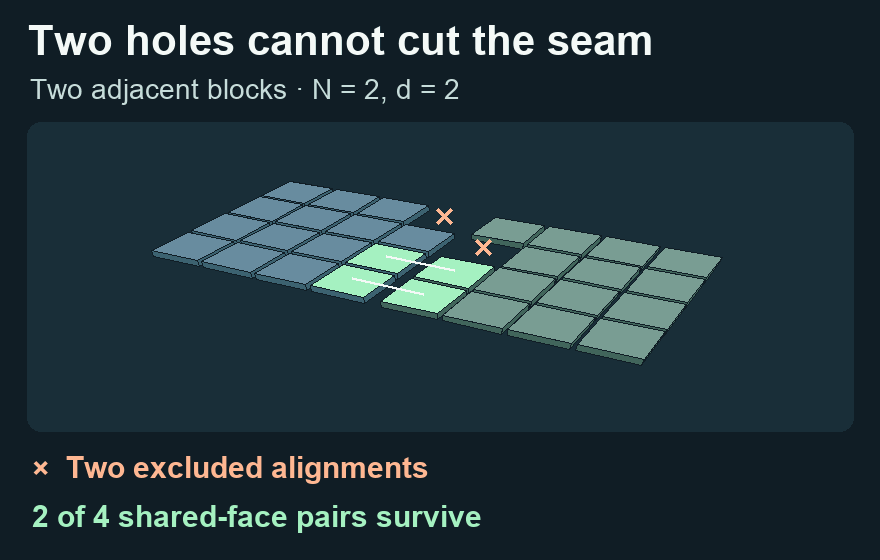

# The dust in fat fractal percolation has zero volume

   

For independent level-dependent fractal percolation with positive retention product and dimension at least two, almost every surviving point belongs to a nontrivial connected component, almost surely.

[Paper](paper/manuscript.pdf) · [TeX](paper/manuscript.tex) · [Open Problem 1.10](https://alea.math.cnrs.fr/articles/v9/09-12.pdf#page=5) · [Version DOI](https://doi.org/10.5281/zenodo.24574115)

## Explore the proof in 3D

Remove one tile from each four-by-four square. At least two of the four aligned pairs on their shared side survive. The proof repeats this choice at every depth to preserve intersection of the closed descendants.

[Download the offline explorer](https://raw.githubusercontent.com/DannyExperiments/fat-percolation-zero-volume-dust/v1.0.0/visualization/shared-face-explorer.zip) · [Explorer source](visualization/index.html) · [Worked example](proof/worked-face.md) · [GIF renderer](visualization/render.py)

## Why the proof works

Use two-level block cubes and call a cube good if it passes its local retention test and has at most one bad block child. Two bad children are needed to fail the recursive part, so its probability is quadratic. Keeping the actual level-dependent failure probabilities makes the overall bad probabilities summable. Almost every surviving point eventually follows good cubes at every block level. All good children together form a connected continuation of positive diameter through such a point.

Earlier work already constructs nearly full block subtrees and uses compatible good cubes for crossings. The measure result uses summable defects and retains all good children. [Prior-work comparison](audits/public_safe_reports/LITERATURE.md)

## Reproduce the checks

    python3 -I scripts/verify_repository.py
    python3 -I verification/src/replay.py

[Recorded replay](verification/results/replay.txt) · [Scope](CLAIM_SCOPE_AND_LIMITATIONS.md) · [Research disclosure](AI_DISCLOSURE.md)

## Cite

DannyExperiments. *The dust in fat fractal percolation has zero volume*. Version 1.0.0, 27 November 2026. [Version DOI](https://doi.org/10.5281/zenodo.24574115).

## Partial Lean verification

For an arbitrary finite horizon read backwards from the terminal cube, the quadratic pair-defect recursion keeps every failure bound below its small threshold and bounds the total by twice the sum of local errors. The certificate retains the final boundary term. Independence gives the probability recursion. Passage to the infinite tail, face-connected descendants and the measure-zero conclusion are in the manuscript. [Formal statement and replay](formal/closing/README.md)
